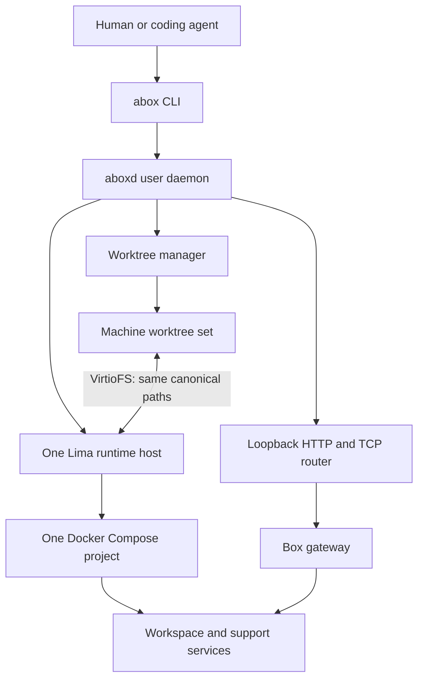
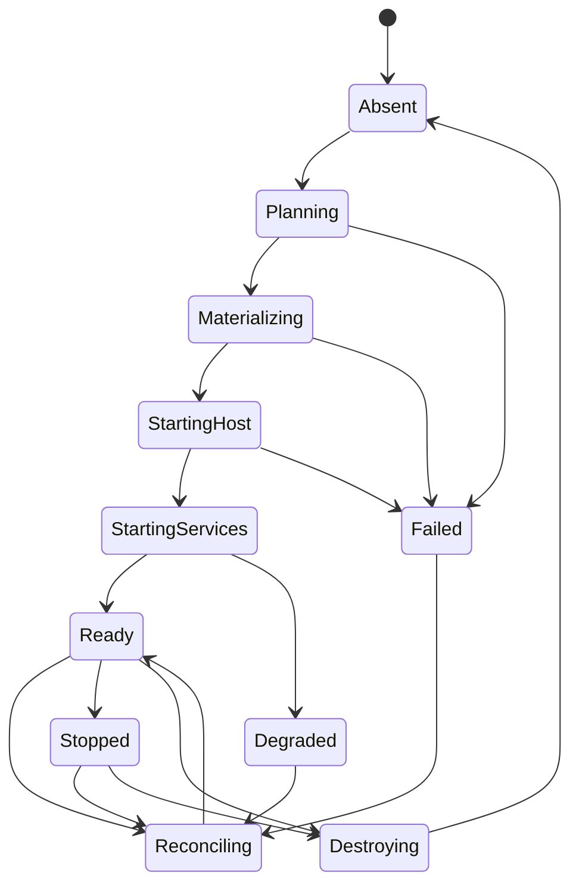
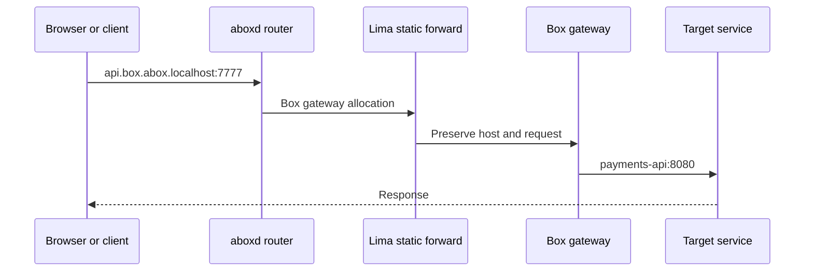

This becomes WHATS_NEXT.md

# Agent Box

## Implementation Kickoff Specification

| | |
| --- | --- |
| **Status** | Proposed implementation baseline |
| **Target release** | `v0.1.0` |
| **CLI** | `abox` |
| **Primary platform** | Apple Silicon macOS 13+ |
| **Implementation lane** | Linux first; Darwin/arm64 VZ and VirtioFS validation is the final pre-RC hardware gate |
| **Implementation language** | Go |
| **License** | Apache-2.0 |

> One task workspace. One isolated Linux host. One generated worktree per repository. One container graph. One command.

---

## 1. Executive decision

Agent Box is a local development runtime for humans and coding agents. Its unit of execution is a **Box**: a named, reproducible task environment containing exactly one workspace, one isolated Linux runtime host, one coordinated set of Git worktrees, and any number of containers.

The golden path is intentionally boring:

```bash
abox up AUTH-142
```

That command must:

1. Resolve the workspace manifest and the requested task.
2. Create one linked worktree for every declared repository.
3. Start one isolated Lima VM for the Box.
4. expose only the Box's worktrees and required Git metadata to that VM.
5. Compile the repository-owned Compose files plus Agent Box policy into one deterministic Compose project.
6. Start the workspace service and all required support services.
7. Wait for declared readiness gates.
8. Register stable local HTTP routes and TCP endpoints without colliding with another Box.
9. Emit a machine-readable context document that tells an agent exactly where it is and how to operate.
10. Return success only when the Box is genuinely ready to use.

Running the same command again must reconcile the existing Box. It must not create a second Box, duplicate worktrees, reset databases, discard edits, or blindly rerun one-time setup.

Agent Box is not a wrapper around `docker compose up`. The actual product is the coordination contract around Git, filesystems, isolation, service lifecycle, recovery, and safe destruction.

**Durability boundary:** filesystem synchronization provides operational redundancy; Git provides history and recovery. v0.1 accepts that a catastrophic disk, application, synchronization, or I/O failure can destroy one Box's uncommitted work and unpushed commits. Agent Box must not advertise snapshots or backup semantics it does not implement.

---

## 2. Product thesis

Development environments fail at their seams:

- Git understands repositories and worktrees but not VM mount topology.
- A VM provides an isolation boundary but does not understand a multi-repository task.
- Compose understands containers but not the lifecycle of host worktrees or agent context.
- Dev Container metadata describes a workspace container but not a multi-repository runtime host.
- Coding agents can run commands but should not have to reverse-engineer any of the above.

Agent Box owns those seams and delegates the underlying work to existing tools. It does not replace Git, Lima, Docker, Compose, or the Dev Container ecosystem.

The product promise is:

> If `abox up` succeeds, every declared repository, service, route, cache, and readiness check belongs to the same task environment and agrees on its identity, paths, and lifecycle.

---

## 3. Vocabulary and atomic unit

Ambiguous infrastructure nouns will wreck the implementation. These terms are normative.

| Term | Meaning |
| --- | --- |
| **Machine** | The developer's physical macOS or Linux computer. Never call this the host in code or documentation. |
| **Workspace** | A declarative set of repositories, services, routes, caches, setup jobs, and policies. Stored in `.abox/box.yaml`. |
| **Task key** | A human-supplied stable identifier such as `AUTH-142` or `refactor-billing`. |
| **Box** | One materialized Workspace for one task key. This is Agent Box's atomic lifecycle and isolation unit. |
| **Runtime host** | The single Linux VM owned by one Box. In v0.1 this is a Lima VZ VM. |
| **Worktree set** | Exactly one generated Git worktree per repository declared by the Workspace. |
| **Workspace service** | The container in which a human or agent runs development commands. It may also run the primary application process. |
| **Support service** | Any sibling container such as Postgres, Redis, LocalStack, an API, or a frontend. |
| **Box gateway** | The generated in-VM HTTP reverse proxy connected to the Box's Compose network. |
| **Plan** | The normalized, validated, immutable description of the resources needed for a specific Box. |
| **Observed state** | What currently exists on the Machine, in Lima, in Git, and in Docker. |
| **Reconciliation** | The process of comparing Plan with observed state and applying only the required operations. |

The Box identity is the tuple:

```text
(workspace_id, task_key)
```

The display ID is deterministic:

```text
<task-slug>-<first-8-base32-sha256(workspace_id + NUL + task_key)>
```

This makes `abox up AUTH-142` idempotent from the same Workspace while preventing collisions between unrelated projects that use the same ticket number.

---

## 4. v0.1 goals, guarantees, and non-goals

### 4.1 Goals

The first release must provide:

- One-command creation and reconciliation.
- Multiple local or remote Git repositories in one task workspace.
- Automatically created, locked, safely removed Git worktrees.
- One Lima VM per Box on Apple Silicon macOS.
- Bidirectional, host-authoritative source visibility through VirtioFS.
- One Compose project assembled from repository-owned Compose files.
- A designated workspace service for `exec`, `shell`, and agent processes.
- Stable loopback-only HTTP routes and collision-free TCP ports.
- Health-aware readiness rather than “the container process started.”
- Deterministic generated plans and an inspectable operation journal.
- Safe resume after CLI termination, daemon restart, or Machine reboot.
- Human output, stable JSON output, and useful exit codes.
- Destruction that refuses to discard dirty worktrees.

### 4.2 Hard guarantees

If `abox up` returns exit code `0`:

1. There is exactly one Box record for the Workspace and task key.
2. Every required repository has a valid worktree at the recorded commit and branch.
3. The runtime host is running the plan's pinned host configuration.
4. Every required service is running.
5. Every required health gate is passing.
6. Every declared route or port is reachable from the Machine.
7. A write made on the Machine is readable in the workspace service, and a write made in the workspace service is readable on the Machine.
8. The generated context document matches the live Box.
9. No secret value appears in the plan, state database, event journal, or normal command output.

### 4.3 Non-goals for v0.1

The following are explicitly out:

- Kubernetes.
- Cloud-hosted Boxes.
- Windows and WSL2.
- Intel macOS.
- A hypervisor or container-engine plugin marketplace.
- Full Dev Container Specification compatibility.
- Automatic translation of arbitrary `devcontainer.json` files.
- VM snapshot or restore commands.
- Transparent TLS and automatic certificate-authority installation.
- A custom DNS server or Machine-wide resolver changes.
- Binding privileged Machine ports `80` or `443`.
- Dynamic discovery of arbitrary exposed container ports.
- MCP as the primary API.
- Running mutually hostile tenants on one Machine.
- Linux Foundation or CNCF application work before users exist.

These are not rejected forever. They are prevented from destabilizing the first vertical slice.

---

## 5. Architectural decisions

| Area | v0.1 decision | Why |
| --- | --- | --- |
| Box isolation | One Lima VM per Box | Strong lifecycle ownership, predictable cleanup, and fewer cross-task collisions. |
| macOS virtualization | Lima with Apple Virtualization Framework (`vz`) | It is the narrowest practical path on Apple Silicon and supports VirtioFS. |
| Container runtime | Docker Engine and Compose v2 inside the VM | Compose compatibility matters more than runtime abstraction in the first release. |
| Docker privilege | Rootful daemon inside the disposable VM; socket never exposed to workspace containers | Maximum Compose/image compatibility while keeping the dangerous daemon out of the Machine and agent container. |
| Source authority | The Box's Machine-side worktrees and private Git stores are canonical; the VM and containers receive a synchronized filesystem view | There is one write history, no merge arbitration between runtime layers, and ordinary VM loss does not define source history. |
| Git containment | Create one private bare Git store per repository per Box, then create the Box worktree from it | Agents can commit normally without mutating the user's source repository metadata or another Box. |
| Git portability | Preserve the same canonical absolute paths on Machine, VM, and workspace service, gated by the real VirtioFS path probe | Stock Git works through Linux bind mounts without rewriting `.git` internals; VZ/VirtioFS transport remains unproven until the Darwin/arm64 hardware gate. |
| Services | Compose is the service graph | Do not invent a weaker Compose clone in Agent Box YAML. |
| Multi-repo Compose | Generate a root Compose file that uses Compose `include` | Each repository keeps its own path base and ownership boundary. |
| Runtime adaptation | Generate an Agent Box override file | Inject labels, mounts, the gateway, network policy, and port suppression without editing repository files. |
| Networking | One unprivileged IPv4 loopback HTTP listener plus `*.abox.localhost` hostnames, with resolver and proxy-bypass preflight | No root, DNS daemon, `/etc/hosts`, or resolver mutation; `.localhost` alone does not defeat an explicit proxy. |
| Control plane | `abox` CLI talks to user-scoped `aboxd` over a Unix socket | Long-lived routing and serialized reconciliation require a daemon. |
| Guest control | Invoke pinned tools through Lima's control/SSH channel | No custom guest daemon until a measured requirement justifies one. |
| State | SQLite in WAL mode plus an append-only operation journal | Transactional local state, crash recovery, inspectability, and simple distribution. |
| Agent integration | JSON context and structured CLI first; MCP adapter later | One stable core API can serve every agent vendor. |
| Extensibility | Internal Go interfaces, no public plugin ABI | Preserve implementation seams without freezing bad abstractions. |

### 5.1 Why the Lima Go package is not the integration boundary

Agent Box will execute and version-check the `limactl` CLI. It will not import unstable Lima internals into the core binary. A CLI compatibility adapter is easier to pin, test against multiple Lima releases, and replace than an accidental source-level dependency on internal VM behavior.

### 5.2 Why there is no guest daemon

The first release needs to:

- provision the VM;
- invoke Docker Compose;
- inspect containers and health;
- stream logs;
- create static port forwards; and
- run commands in the workspace service.

Lima and Docker already expose these operations. A custom always-on guest process would add version negotiation, installation, upgrades, authentication, logs, and failure modes before it adds unique value. Runtime event streaming can be introduced later behind the existing guest-control interface.

### 5.3 Why Compose is the only service model

Agent Box YAML must not duplicate images, build contexts, health checks, dependency conditions, profiles, secrets, networks, volumes, and restart behavior already represented by Compose. Repositories continue to own their service definitions. Agent Box owns only cross-repository composition and Box-specific policy.

### 5.4 Milestone 0 evidence boundary

The measured substrate gate is published in [`docs/architecture/substrate-spikes.md`](docs/architecture/substrate-spikes.md) and accepted by [`ADR 0001`](docs/decisions/0001-milestone-0-substrate-gate.md). Product implementation may proceed only while every Linux-exercisable critical probe is green on the exact recorded matrix. A failed Git, Compose, routing, ownership, cleanup, or recovery probe blocks the affected implementation until the mechanism or this specification changes explicitly.

The Linux probes narrowed three assumptions:

- identical absolute Git paths work through the tested bind-mount boundary, but remain conditional across Lima VZ and VirtioFS;
- repository port suppression depends on a pinned Compose version that demonstrably normalizes the generated `!reset []` override before apply; and
- wildcard `.localhost` routing is proven on an unprivileged IPv4 listener only when resolver and proxy-bypass behavior pass preflight.

The later [Apple M1 gate](docs/architecture/apple-silicon-m1-gate.md) verified the single-repository VZ lifecycle, mount allowlist, and bounded VirtioFS visibility and bridged watcher behavior on its recorded stack. Concurrent Lima forwarding, Darwin resolver/browser behavior, crash recovery, and multi-version release support still require the [Milestone 5 hardware gate](ROADMAP.md#milestone-5-releasable-v01-candidate). Cross-compilation is not runtime evidence.

---

## 6. System architecture



### 6.1 Machine components

#### `abox`

The CLI is deliberately thin. It:

- discovers `.abox/box.yaml`;
- validates local arguments;
- starts `aboxd` if necessary;
- sends a versioned request over a Unix domain socket;
- renders streamed events for a human or as NDJSON; and
- exits with a stable code.

It does not directly mutate Git, Lima, Docker, or SQLite when the daemon is available.

#### `aboxd`

The daemon owns:

- Box identity and locking;
- manifest compilation;
- state and operation journals;
- worktree lifecycle;
- Lima lifecycle;
- Compose execution;
- port allocation;
- the Machine-side HTTP router;
- readiness evaluation;
- secret resolution and redaction; and
- garbage collection.

It listens only on a Unix socket with mode `0600`. It never exposes a TCP control API.

#### Machine router

The router listens on configurable unprivileged loopback ports, defaulting to:

```text
HTTP: 127.0.0.1:7777
TCP allocation range: 127.0.0.1:20000-39999
```

The HTTP route form is:

```text
http://<route>.<box-id>.abox.localhost:7777
```

The suffix `.localhost` is reserved for loopback use. Agent Box does not rely on public DNS.

### 6.2 Runtime-host components

Each Box owns:

- one generated Lima configuration;
- one VM disk;
- one Docker Engine;
- one generated Compose root file;
- one generated Compose override;
- one Compose project and default network;
- one Box gateway service;
- Box-scoped named volumes; and
- explicitly mounted worktrees and Git metadata.

The VM does not mount the user's home directory. The generated Lima configuration contains only the exact mount paths required by the Plan.

### 6.3 Container roles

The workspace service is declared by name. It receives:

- every worktree required for development;
- the Git metadata allowed by policy;
- Box context environment variables;
- selected caches;
- selected secrets; and
- the default working directory.

Support services receive only the repository mounts and secrets explicitly assigned to them. No service receives the Docker socket by default.

---

## 7. Workspace manifest

The manifest describes cross-repository intent. It does not attempt to restate Compose.

```yaml
apiVersion: abox.dev/v1alpha1
kind: Workspace

metadata:
  name: billing-platform

spec:
  repositories:
    - name: payments
      source:
        local: ../payment-service
      checkout:
        ref: HEAD
        branch: "abox/{{ box.task }}/payments"
      workspacePath: services/payments

    - name: portal
      source:
        remote: git@github.com:example/frontend-portal.git
      checkout:
        ref: origin/main
        branch: "abox/{{ box.task }}/portal"
      workspacePath: apps/portal

  host:
    cpus: 6
    memory: 12GiB
    disk: 60GiB

  compose:
    includes:
      - repository: payments
        path: compose.dev.yaml
      - repository: portal
        path: compose.dev.yaml
    profiles:
      - development

  workspaceService:
    name: payments-api
    repository: payments
    workingDirectory: services/payments

  mounts:
    - repository: payments
      services: [payments-api]
      mode: read-write
    - repository: portal
      services: [payments-api, portal-web]
      mode: read-write

  caches:
    - name: pnpm-store
      service: payments-api
      target: /home/dev/.local/share/pnpm/store
    - name: go-build
      service: payments-api
      target: /home/dev/.cache/go-build

  setup:
    - name: install-payments
      service: payments-api
      command: ["pnpm", "install", "--frozen-lockfile"]
      rerunWhenChanged:
        - payments/pnpm-lock.yaml
    - name: migrate-database
      service: payments-api
      command: ["pnpm", "db:migrate"]
      after: [install-payments, postgres-ready]
      rerun: everyStart

  routes:
    - name: api
      service: payments-api
      targetPort: 8080
      readiness:
        http:
          path: /healthz
          expectedStatus: 200
        timeout: 90s
    - name: portal
      service: portal-web
      targetPort: 3000
      readiness:
        http:
          path: /
          expectedStatus: 200
        timeout: 120s

  tcpPorts:
    - name: postgres
      service: postgres
      targetPort: 5432
      allocate: dynamic

  secrets:
    - name: OPENAI_API_KEY
      fromHostEnvironment: OPENAI_API_KEY
      exposeTo:
        - service: payments-api
          as: environment

  policy:
    gitMetadata: read-write
    dockerSocket: deny
    machineMounts: declared-only
    networkEgress: allow
```

### 7.1 Manifest rules

- Unknown fields are errors in `v1alpha1`. Silent typos are unacceptable.
- Repository names, service names, route names, cache names, and setup job names must be unique in their namespace.
- All relative paths are resolved against the manifest directory and canonicalized with `realpath` semantics.
- A canonical path may not escape an explicitly allowed root through `..` or symlink traversal.
- Compose service names must be globally unique after all includes are merged.
- Every route and TCP endpoint must reference an existing service.
- Every required route must define a readiness probe or target a service with a Compose health check.
- Secret sources are references only. Secret values are forbidden in the manifest.
- Shell strings are forbidden for setup commands in v0.1. Commands use an argument array to avoid accidental shell interpolation.
- Resource quantities are normalized to bytes and millicores in the Plan.
- Templates are limited to documented values. No arbitrary template functions or command execution is permitted.

### 7.2 Dirty source behavior

Agent Box never silently ignores edits in the source checkout.

For a local repository:

- If the source checkout is clean, `HEAD` is resolved normally.
- If it is dirty, `abox up` fails with exit code `7` and prints the changed paths.
- `--from-working-copy` is an explicit future feature, not v0.1 magic.

This prevents a user from believing an agent can see uncommitted work that was never copied into a linked worktree. It also prevents untracked secrets from being swept into a Box.

---

## 8. Spec, Plan, and State

Agent Box maintains three separate representations. Combining them would make reconciliation impossible to reason about.

### 8.1 Spec

The Spec is the user-authored Workspace manifest plus CLI overrides. It may contain relative paths, symbolic refs such as `HEAD`, and image tags.

### 8.2 Plan

The Plan is immutable for one reconciliation attempt. It contains:

- `workspaceId` and `boxId`;
- the canonical manifest path and digest;
- canonical Machine paths;
- repository common Git directories;
- resolved base commit SHAs;
- generated branch names;
- Lima instance name and normalized resources;
- the exact mount allowlist;
- Compose input files and digests;
- selected profiles;
- generated route names;
- reserved Machine ports;
- setup job keys;
- secret references, never values;
- tool and schema versions; and
- a canonical `planDigest`.

Canonical JSON is used for hashing. Map keys are sorted, durations and sizes are normalized, paths are canonical, and secrets are represented by opaque reference IDs.

An abridged Plan looks like:

```json
{
  "schemaVersion": "abox.plan/v1alpha1",
  "workspaceId": "ws_h7n2x0m4",
  "boxId": "auth-142-3m6y4k2p",
  "taskKey": "AUTH-142",
  "repositories": [
    {
      "name": "payments",
      "baseCommit": "b6ea6ef0d5746f61f1a72df9c9e44abdb19d472a",
      "branch": "abox/auth-142/payments",
      "worktreePath": "/Users/shoe/Library/Application Support/Agent Box/boxes/auth-142-3m6y4k2p/workspace/services/payments",
      "gitCommonDir": "/Users/shoe/Library/Application Support/Agent Box/boxes/auth-142-3m6y4k2p/git/payments.git"
    }
  ],
  "runtimeHost": {
    "driver": "lima-vz",
    "cpus": 6,
    "memoryBytes": 12884901888,
    "diskBytes": 64424509440
  },
  "routes": [
    {
      "name": "api",
      "url": "http://api.auth-142-3m6y4k2p.abox.localhost:7777",
      "service": "payments-api",
      "targetPort": 8080
    }
  ],
  "secretRefs": ["host-env:OPENAI_API_KEY"],
  "planDigest": "sha256:..."
}
```

### 8.3 Observed state

Observed state is read from reality on every reconcile:

- `git worktree list --porcelain -z`;
- filesystem existence and ownership;
- `limactl list --json` and instance inspection;
- Docker Compose and container inspection inside the VM;
- live health probes;
- active port listeners; and
- recorded setup stamps.

SQLite is a cache and coordination store, not the sole source of truth. If SQLite says a VM exists and Lima says it does not, the VM does not exist.

### 8.4 Compiled Compose model

The daemon generates two files under the Box's private state directory:

1. `compose.root.yaml`, which includes repository-owned Compose files with each file's own project directory.
2. `compose.abox.yaml`, which injects Box labels, source mounts, caches, network attachment, the gateway, and Box policy.

The pinned Docker Compose CLI performs include resolution, interpolation, schema validation, and normalization. Agent Box does not reimplement Compose merge semantics.

Before starting services, the daemon captures:

```bash
docker compose \
  --project-name <box-compose-id> \
  --env-file /run/abox/<box-id>/compose.env \
  -f compose.root.yaml \
  -f compose.abox.yaml \
  config --format json
```

The normalized model is hashed and retained with secrets redacted. Repository-declared Machine port publications are reset in the generated override; external access must be declared through `routes` or `tcpPorts` so Boxes cannot collide.

---

## 9. Reconciliation and lifecycle

`abox up` is a reconciler, not a script. Each external side effect is represented as an idempotent operation with an observation function.



### 9.1 Required state values

```text
ABSENT
PLANNING
MATERIALIZING
STARTING_HOST
STARTING_SERVICES
READY
DEGRADED
STOPPED
FAILED
DESTROYING
```

State transitions are persisted before and after each operation. `FAILED` is not terminal; it records the last failed operation and allows the next `up` to resume from observed reality.

### 9.2 Operation contract

The internal operation seam is intentionally small:

```go
type Operation interface {
    Key() string
    Dependencies() []string
    Observe(ctx context.Context) (Observation, error)
    Apply(ctx context.Context, before Observation) (Result, error)
    Compensate(ctx context.Context, result Result) error
}
```

Rules:

- `Key` is stable for the same logical resource.
- `Observe` is read-only.
- `Apply` must be safe after an unknown partial execution.
- `Compensate` is used only for resources created by the current failed attempt.
- Compensation may never delete a pre-existing resource.
- A destructive operation must prove its target is owned by the Box.
- Operations touching the same Box are serialized by the daemon.
- Independent pulls, builds, and readiness probes may run concurrently with bounded fan-out.

### 9.3 Operation DAG for `up`

| Order | Operation | Ready condition |
| --- | --- | --- |
| 1 | Acquire Box lease | This daemon owns an unexpired lease for `(workspace_id, task_key)`. |
| 2 | Validate Machine | Supported OS/architecture, disk space, tool integrity, router availability. |
| 3 | Resolve repositories | Every source exists or has been fetched; every ref resolves to one commit. |
| 4 | Create worktrees | Every worktree is registered, locked, on the expected branch, and at the expected base. |
| 5 | Materialize Plan | Canonical plan and digests are stored atomically. |
| 6 | Reserve ports | Router/gateway/TCP allocations are unique and held by the daemon. |
| 7 | Create runtime host | Lima config exactly matches immutable host fields. |
| 8 | Start runtime host | Lima reports running and the control channel responds. |
| 9 | Verify mounts | Every allowed path is present; a bidirectional probe succeeds; no undeclared mount exists. |
| 10 | Verify runtime | Pinned Docker and Compose versions respond. |
| 11 | Compile Compose | Includes resolve, model validates, forbidden fields are absent, digest is recorded. |
| 12 | Pull/build services | Required images exist and builds succeed. |
| 13 | Start services | Compose reports required containers running. |
| 14 | Run setup DAG | Required jobs have successful stamps for their current keys. |
| 15 | Start Box gateway | Gateway can reach every declared HTTP target. |
| 16 | Evaluate readiness | All required health gates pass before their deadlines. |
| 17 | Register routes | Machine router can reach the Box gateway and TCP targets. |
| 18 | Write context | Context is atomically written and matches the live generation. |
| 19 | Mark ready | State transaction commits `READY` with the current generation and plan digest. |

### 9.4 Reconcile behavior

Changes are classified:

| Change | Action |
| --- | --- |
| Route or readiness configuration | Reconfigure gateway/router and probe again. |
| Compose service/image/build configuration | Run targeted Compose reconciliation. |
| Setup job inputs or command | Invalidate only that job's stamp and its dependents. |
| Worktree edits | No runtime mutation; edits are normal observed workspace state. |
| VM CPU or memory | Stop and restart the VM after explicit notice. |
| VM disk increase | Apply supported growth operation; shrinking is rejected. |
| Base ref or generated branch for an existing dirty Box | Reject as a conflict. Never reset the worktree. |
| Repository removed from Spec | Refuse while its worktree is dirty; otherwise remove during reconcile. |
| Secret reference changed | Restart only consumers; never persist the value. |

---

## 10. Git and worktree design

Git is the v0.1 safety mechanism and the highest-risk shared state in a development runtime. The key containment decision is that a Box never creates its worktrees directly from the user's source repository. Every declared repository receives a **private bare Git store inside the Box**, and the generated worktree is linked only to that store.

This produces the required unit of failure:

```text
Box
├── git/payments.git       # Box-private Git objects, refs, config, index metadata
└── workspace/payments     # linked worktree used by the human and agent
```

An agent can stage, commit, rebase, and create branches without mutating the user's source repository metadata or another Box. If the Box is catastrophically corrupted, its unpushed commits and uncommitted files may be lost together. That is the accepted v0.1 loss envelope.

The implementation uses Git porcelain/plumbing output intended for scripts and never parses human-formatted status text.

### 10.1 Local repository flow

For each repository with `source.local`:

1. Resolve the source with `git -C <path> rev-parse --show-toplevel`.
2. Require a clean source checkout so the Box cannot silently omit uncommitted work.
3. Resolve `checkout.ref` to a full 40-character commit ID.
4. Create a self-contained bare repository at `<box-root>/git/<repository>.git`.
5. Copy or fetch the required objects and refs without Git alternates or writable hardlinks to the source repository.
6. Configure the source repository or its canonical remote as the Box repository's publish destination.
7. Enable reflogs for the Box repository with `core.logAllRefUpdates=true`.
8. Create the generated task branch and linked worktree under the Box workspace root.
9. Lock the worktree with a reason containing the Box ID.
10. Verify it appears exactly once in `git worktree list --porcelain -z` from the Box-private bare repository.
11. Record device/inode identity for the worktree root and Box-private Git directory.

Conceptually:

```bash
git clone --bare --no-hardlinks <source> <box-git-dir>
git -C <box-git-dir> config core.logAllRefUpdates true
git -C <box-git-dir> worktree add -b <generated-branch> <worktree-path> <base-commit>
git -C <box-git-dir> worktree lock --reason "owned by Agent Box <box-id>" <worktree-path>
```

The exact seeding implementation may use an APFS copy-on-write clone for speed, but the result must have copy-on-write isolation. An Agent Box write may not modify a source-repository inode or a sibling Box's Git store.

### 10.2 Remote repository flow

Remote sources are fetched on the Machine using the user's existing Git credential mechanism. Credentials are not copied into the VM.

Agent Box may maintain a Machine-side read-only repository cache keyed by canonical remote URL to avoid repeated network downloads. A Box Git store seeded from that cache must be dissociated before the workspace service receives write access: it may not retain an `objects/info/alternates` dependency on a mutable cache.

The Box-private store records the canonical remote as its publish destination. Source and Git writes occur inside the Box; network publication is explicit.

### 10.3 Commit and publish flow

Commits made in the workspace service immediately update the Box-private Git store on the Machine-side synchronized filesystem. They survive ordinary container and VM replacement. They do not automatically change the user's original checkout or leave the Machine.

Publication is explicit:

```bash
abox publish AUTH-142
abox publish AUTH-142 --repository payments
```

`publish` uses the user's normal Machine credential mechanism, shows the source and destination refs, and refuses non-fast-forward replacement unless the user supplies a separate explicit policy. It never sends credentials into the Box.

The Machine must not execute Git while trusting configuration or hooks writable by the agent. Publication crosses the boundary through data:

1. Git inside the Box produces a bundle for the exact selected commits and refs.
2. The Machine validates that bundle and imports it into a fresh, ABox-controlled temporary bare repository.
3. The daemon pushes from that sanitized repository to the destination recorded in the Plan, not a destination read from Box-writable Git config.
4. Machine-side hooks are disabled for the operation and the temporary repository is removed after the result is recorded.

This keeps arbitrary hooks, `core.sshCommand`, upload-pack hooks, filters, and other Box-writable Git configuration from becoming a code-execution bridge onto the Machine.

A user may also enter the Machine-side Box worktree and use ordinary host Git. `abox status` and the context document must clearly distinguish:

- uncommitted changes;
- local Box commits not published anywhere;
- commits published to a local source repository; and
- commits pushed to an external remote.

### 10.4 Path invariance

Linked worktree `.git` files normally point to repository administration paths. v0.1 preserves those paths instead of rewriting them:

- the Machine worktree path is mounted into the VM at the identical absolute path;
- the common Git directory is mounted at the identical absolute path;
- the workspace service bind-mounts both at the identical absolute paths; and
- `abox shell` starts in that canonical path.

This is ugly in the way good substrate engineering is often ugly: `/Users/...` exists inside the Linux VM and container. The payoff is that stock Git sees one coherent topology on every layer.

Agent Box must run a feasibility gate against paths containing spaces, Unicode, long components, and symlinks before this design is accepted.

### 10.5 Relative worktree paths

Modern Git supports `worktree.useRelativePaths`, specifically for repositories and worktrees that move between environments. It also enables the `extensions.relativeWorktrees` repository extension, which older Git clients cannot read.

Therefore:

- Agent Box never enables it in a user-owned repository.
- It may be enabled in a Box-private Git store only when every Git client used by the Box satisfies the recorded minimum version.
- The doctor command reports whether relative mode is safe.
- Manual rewriting of `.git` pointer files is forbidden.

### 10.6 Git metadata policy

Default policy is:

```yaml
policy:
  gitMetadata: read-write
```

The workspace service can inspect, stage, commit, rebase, and otherwise use ordinary Git. This is intentional: Git commits are the v0.1 recovery boundary for meaningful work. The writable metadata belongs only to this Box, limiting an agent's direct Git blast radius to the Box it already controls.

Hardened or inspect-only workspaces may opt into:

```yaml
policy:
  gitMetadata: read-only
```

The workspace service can then inspect status and diffs but cannot stage or commit. Source files remain read-write. The CLI must state that uncommitted work has no Git recovery point until a Machine-side process commits it.

### 10.7 Submodules

Linked worktree support for superprojects containing submodules remains incomplete in Git. v0.1 rejects repositories with active submodules and reports the detected paths. Supporting them requires a separate clone strategy and its own acceptance suite; it is not a hidden special case in worktree creation.

### 10.8 Safe removal

`abox rm` performs these checks before removing any worktree:

1. The canonical target is beneath the recorded Agent Box workspace root.
2. The worktree is registered to the expected Git common directory.
3. Its branch matches the Box record.
4. `git status --porcelain=v2 -z --untracked-files=all` is empty.
5. Every Box commit is reachable from the recorded local source or external publish destination.
6. No untracked or ignored file is being implicitly discarded by a raw directory deletion.

Dirty or unpublished removal is refused. There is no ambiguous `--force`. The explicit escape hatch is:

```bash
abox rm AUTH-142 \
  --discard-worktree-changes \
  --discard-unpublished-commits \
  --delete-volumes
```

The command prints the exact changed files, unpublished commit IDs, worktrees, Git stores, and volumes that will be destroyed before a human confirmation. In non-interactive mode, every applicable destructive flag plus `--yes` is required.

---

## 11. Filesystem contract

“Synchronized filesystem” is a coherency contract: a completed write on the Machine must become visible inside the workspace service, and a completed write in the workspace service must become visible on the Machine. The Box's Machine-side worktree and private Git store are authoritative. v0.1 uses VirtioFS to present them through the VM rather than inventing a second conflict-resolving source history.

The synchronization layer provides operational redundancy across runtime layers, but the implementation must not imply that it is an independent backup. Whether a given mechanism maintains duplicate blocks, caches, or a second on-disk representation is not part of the durability contract.

### 11.1 Source mounts

On macOS v0.1:

- Lima uses `vz` plus VirtioFS.
- Only worktrees and required Git metadata are mounted.
- Source mounts are writable only for services explicitly granted read-write access.
- The Machine's home directory is not mounted wholesale, even read-only.
- Dependency and compiler caches live on the VM disk as named volumes.

### 11.2 Cache separation

High-churn dependency directories should not live on VirtioFS unless the repository requires Machine visibility.

Default guidance:

| Data | Location | Reason |
| --- | --- | --- |
| Source, tests, config | Machine worktree via VirtioFS | Bounded visibility and Machine-side persistence; see ADR 0011. |
| `node_modules` | Box-scoped named volume | Metadata-heavy workload and platform-specific binaries. |
| PNPM/Yarn/npm download store | Box-scoped named volume | Reusable within Box without polluting source. |
| Python virtualenv | Box-scoped named volume | Linux executables must not be shared with macOS. |
| Go build/module cache | Box-scoped named volumes | Performance and platform correctness. |
| Cargo target directory | Box-scoped named volume | Avoid heavy cross-boundary filesystem traffic. |
| Database files | Box-scoped named volume | Correct locking and I/O semantics. |

The tradeoff is explicit: Machine-side language servers will not see container-only dependency trees. The recommended IDE mode is to attach to the workspace service. Agent Box will not duplicate dependencies merely to make both environments pretend to be native.

### 11.3 Durability and accepted loss

Filesystem synchronization is operational redundancy. It is not backup, history, or a transactional durability protocol.

The v0.1 safety model is:

- ordinary container deletion does not delete the Machine-side worktree;
- ordinary VM stop or replacement does not delete the Machine-side worktree;
- synchronized visibility keeps the active Box usable from both sides of the runtime boundary;
- a Git commit in the Box-private store is the first durable, inspectable recovery point for source work during ordinary runtime churn;
- a push or external repository backup is the first recovery point outside the Machine; and
- uncommitted changes and unpushed Box commits may be lost after a filesystem bug, disk fault, application defect, synchronization failure, or severe I/O corruption.

That one-Box loss envelope is accepted for v0.1. Agent Box does not create automatic commits, stashes, patches, volume archives, or filesystem snapshots. It must never claim those protections exist.

The blast-radius objective is **one Box**: corruption of one Box's worktree, private Git store, VM disk, generated state, or volumes must not make the user's source repository or sibling Boxes unrecoverable. Git integrity checks, explicit publication, and normal repository backups remain the defense.

Future checkpointing, if added, should export explicit Git bundles or patches plus selected volume archives. It must not be built on an experimental VM snapshot interface or described as backup without restore tests.

### 11.4 Filesystem acceptance probes

Before a Box becomes ready, the daemon creates a random probe directory inside each mounted worktree and verifies:

1. Machine write → workspace-service read with exact bytes and mode.
2. Workspace-service write → Machine read with exact bytes and mode.
3. Rename visibility in both directions: the old name is absent and the new name has exact bytes and mode.
4. File deletion visibility in both directions.
5. A watcher in the workspace service receives a create/modify event within one second after its activation handshake.

Each bytes/mode, rename, and deletion observation must converge within two seconds. Retry observations only, never the mutation. This explicitly revises the immediate cross-machine visibility assumption following the measured Darwin run; see [ADR 0011](docs/decisions/0011-bounded-filesystem-visibility.md).

Probe files are created only under `.abox-probe/<nonce>` and removed after success. `.abox-probe/` is added to an Agent Box-managed global excludes file, not to the repository's `.gitignore`.

Native VirtioFS event delivery was tested first and failed on the measured Apple M1 stack. The revised design enables Lima's experimental `mountInotify` bridge for writable mounts and retains a one-second create/modify event deadline after an in-container handshake. Lima's bridge synthesizes Linux `IN_ATTRIB` events for host creates and modifies without changing file contents or modes; host deletion events remain unsupported, so projects requiring deletion events or using watchers that ignore `IN_ATTRIB` must use a polling watcher. `abox doctor fs` is observation-only and may report unknown evidence. Agent Box does not claim perfect event semantics.

### 11.5 Ownership

The Plan records Machine UID and GID. The workspace service must run as a non-root development user compatible with writable mounts. Agent Box does not blindly override `user:` on arbitrary support services because that can invalidate upstream images.

Any attempt by a container to change ownership of a source mount is treated as a diagnostic failure. Cache volumes may use container-native ownership.

---

## 12. Compose and service runtime

### 12.1 Composition

`compose.root.yaml` uses Compose `include` so each repository's paths resolve relative to its own project directory. This avoids the path ambiguity of stacking unrelated files with repeated `-f` flags.

Conceptually:

```yaml
include:
  - path: /canonical/box/workspace/services/payments/compose.dev.yaml
    project_directory: /canonical/box/workspace/services/payments
  - path: /canonical/box/workspace/apps/portal/compose.dev.yaml
    project_directory: /canonical/box/workspace/apps/portal
```

The generated override:

- applies `dev.abox.*` ownership labels;
- attaches services to the Box network;
- suppresses repository-owned Machine port publishing;
- injects declared worktree and cache mounts;
- injects the Box gateway;
- injects readiness metadata; and
- adds secret delivery mechanisms.

### 12.2 Project identity

Every Compose invocation passes an explicit project name derived from the Box ID. Directory names and caller environment variables are never allowed to choose it implicitly.

All generated resources carry labels:

```text
dev.abox.managed=true
dev.abox.workspace=<workspace-id>
dev.abox.box=<box-id>
dev.abox.plan=<plan-digest>
dev.abox.generation=<integer>
```

Cleanup selects by recorded IDs and verifies labels. It never deletes resources based only on a name prefix.

### 12.3 Dependency and readiness semantics

Compose dependency order is respected. A dependency declared with `condition: service_healthy` must become healthy before its dependent starts.

Agent Box adds a stronger Box-level rule:

- **running** means the container process exists;
- **healthy** means the container health check passes;
- **reachable** means the Box gateway or TCP probe can connect;
- **ready** means all required service and route gates pass.

A service without a health check is only process-verified. A required route without an explicit probe is a manifest validation error unless its service has a health check that exercises the same listener.

### 12.4 Setup jobs

Setup jobs are a DAG, not unstructured shell hooks.

Each successful job receives a stamp keyed by:

```text
sha256(
  normalized-command
  + service-image-or-build-digest
  + declared-input-file-digests
  + non-secret-environment-digest
)
```

`rerunWhenChanged` jobs run only when that key changes. `everyStart` jobs run once per runtime-host start generation. A failed job records bounded stdout/stderr, blocks dependents, and leaves the Box `DEGRADED` or `FAILED` according to whether its service graph is otherwise usable.

Jobs run with an argv array. If shell behavior becomes necessary later, it must use an explicit field such as `shell: true` and a declared shell executable.

### 12.5 Dev Container adapter

Dev Container support begins after the core Compose path is stable.

The adapter rules are:

- Use the upstream Dev Container CLI for lifecycle and feature semantics.
- Do not implement a partial home-grown translator and call it compliant.
- A Compose-backed `devcontainer.json` may identify the Workspace service in a later release.
- Standalone image/Dockerfile Dev Containers may be imported into an explicit generated Compose service.
- The imported result must be inspectable and lockable.
- Unsupported properties are errors, not warnings hidden in debug logs.

The first Dev Container milestone is an `abox import devcontainer` command, not implicit auto-discovery during every `up`.

---

## 13. Networking and service exposure

Networking must make parallel Boxes routine without requiring Machine-wide configuration.

### 13.1 In-Box networking

All included services join one Box-scoped Compose network unless the repository explicitly declares additional internal networks. Compose service names provide in-Box discovery:

```text
payments-api:8080
portal-web:3000
postgres:5432
```

Container IP addresses are never stored in the Plan or exposed to users.

### 13.2 HTTP routes

The generated Box gateway joins the Compose network and owns the internal HTTP routing table. It listens on one fixed guest port. Lima forwards that port to a unique, daemon-reserved loopback port on the Machine. The Machine router multiplexes every Box and route on `127.0.0.1:7777` by the HTTP `Host` header.

Request path:



The gateway configuration is generated from the Plan. It does not discover routes by watching Docker events or treating every `EXPOSE` instruction as public intent.

The proxy must support:

- HTTP/1.1 keep-alive;
- WebSocket upgrades;
- server-sent events;
- streaming request and response bodies;
- bounded header sizes and idle timeouts;
- forwarding of the original host and scheme metadata; and
- removal of untrusted inbound Agent Box control headers.

### 13.3 TCP routes

Raw TCP cannot be multiplexed by ordinary HTTP hostnames. For every declared `tcpPorts` entry, the daemon:

1. asks the kernel for an available port in the configured range;
2. holds the reservation while creating the Lima forward;
3. persists the allocation under the Box lease;
4. verifies a connection to the declared guest target; and
5. exposes the result through `abox port` and the context document.

Example:

```bash
abox port AUTH-142 postgres
# 127.0.0.1:23641
```

UDP is out of scope for v0.1.

### 13.4 TLS

The default is plain HTTP on `.localhost`. v0.1 does not:

- create or trust a local certificate authority;
- modify the system keychain;
- bind `443`; or
- terminate TLS using an untrusted self-signed certificate.

Projects that require real local TLS can run it inside a declared service and expose a TCP port. Managed local certificates may be added later as an explicit, separately installed capability.

### 13.5 Collision rules

- A route name must be unique within a Box.
- A Box ID is globally unique on the Machine.
- Machine router ports are owned by the daemon, not individual Boxes.
- TCP allocations remain attached to a stopped Box until removal or explicit release, giving stable reconnect behavior.
- If the configured HTTP router port is occupied by a non-Agent Box process, `aboxd` fails clearly; it never kills or replaces that process.

---

## 14. CLI and agent contract

### 14.1 Human command surface

The v0.1 surface is deliberately small:

```bash
# Create a strict starter manifest without provisioning anything.
abox init

# Create or reconcile a Box for a task.
abox up AUTH-142

# Show the proposed operations without changing anything.
abox plan AUTH-142

# Show Boxes or one Box's detailed status.
abox list
abox status AUTH-142

# Run in the designated workspace service.
abox shell AUTH-142
abox exec AUTH-142 -- pnpm test

# Target another service.
abox exec AUTH-142 --service postgres -- psql --version

# Stream or inspect service logs.
abox logs AUTH-142
abox logs AUTH-142 --service payments-api --follow

# Print or open declared endpoints.
abox routes AUTH-142
abox port AUTH-142 postgres
abox open AUTH-142 portal

# Explicitly publish Box commits through the Machine's Git credentials.
abox publish AUTH-142
abox publish AUTH-142 --repository payments

# Stop services and the VM without deleting worktrees or volumes.
abox down AUTH-142

# Reconcile a stopped Box back to READY.
abox up AUTH-142

# Safely remove a clean Box.
abox rm AUTH-142

# Inspect Machine or Box-specific prerequisites and failure evidence.
abox doctor
abox doctor AUTH-142
```

There is no separate `create` versus `start` distinction in the golden path. `up` means “make reality ready.”

### 14.2 Machine-readable mode

Every non-interactive command supports `--json`. Streaming commands use newline-delimited JSON events on stdout. Human progress is written to stderr so stdout remains parseable.

Example final result:

```json
{
  "schemaVersion": "abox.output/v1alpha1",
  "operationId": "op_01K4M8T4Y8DMG0RMPV3YYPS8RA",
  "box": {
    "id": "auth-142-3m6y4k2p",
    "taskKey": "AUTH-142",
    "state": "READY",
    "workspaceRoot": "/Users/shoe/Library/Application Support/Agent Box/boxes/auth-142-3m6y4k2p/workspace",
    "generation": 4,
    "planDigest": "sha256:..."
  },
  "repositories": [
    {
      "name": "payments",
      "branch": "abox/auth-142/payments",
      "commit": "b6ea6ef0d5746f61f1a72df9c9e44abdb19d472a",
      "path": "/canonical/path/to/services/payments",
      "dirty": false
    }
  ],
  "routes": [
    {
      "name": "api",
      "url": "http://api.auth-142-3m6y4k2p.abox.localhost:7777",
      "ready": true
    }
  ],
  "ports": [
    {
      "name": "postgres",
      "host": "127.0.0.1",
      "port": 23641,
      "ready": true
    }
  ]
}
```

### 14.3 Stable exit codes

| Code | Meaning |
| ---: | --- |
| `0` | Requested state achieved. |
| `2` | CLI usage or manifest validation error. |
| `3` | Unsupported Machine or failed prerequisite. |
| `4` | Ownership, identity, branch, or concurrent-operation conflict. |
| `5` | Infrastructure apply failure. |
| `6` | Services started but readiness failed. |
| `7` | Safety refusal, including dirty source or destructive cleanup refusal. |
| `8` | Box, service, route, or port not found. |
| `9` | Daemon/API version incompatibility. |
| `10` | Internal invariant violation. |

Errors also include a stable symbolic code such as `ABOX_GIT_DIRTY_SOURCE` or `ABOX_ROUTE_NOT_READY`. Agents must branch on symbolic codes, not English messages.

### 14.4 Context document

Each READY generation writes `context.json` into the Box state directory and exposes it through:

```bash
abox context AUTH-142 --json
```

It contains:

- Box, Workspace, task, and generation identity;
- canonical worktree paths;
- repository names, branches, and base commits;
- workspace service and working directory;
- service names and readiness;
- routes and TCP endpoints;
- common commands for tests, logs, and status when declared;
- active policy facts;
- accepted durability statement; and
- the path of the human-readable manifest.

It never contains secret values, host credential locations, Docker socket paths, or unrelated Machine paths.

### 14.5 Daemon API

The daemon serves a versioned HTTP+JSON API over a Unix socket:

```text
POST /v1/boxes:up
POST /v1/boxes/{id}:down
POST /v1/boxes/{id}:remove
POST /v1/boxes/{id}:exec
POST /v1/boxes/{id}:publish
GET  /v1/boxes
GET  /v1/boxes/{id}
GET  /v1/boxes/{id}/context
GET  /v1/operations/{id}/events
```

Long operations stream NDJSON events. Every mutating request carries an idempotency key. The socket is user-owned with mode `0600`; the server rejects requests whose peer identity does not match the daemon user where the platform exposes peer credentials.

MCP, IDE extensions, and agent-specific launchers should wrap this API later. None of them gets a privileged side channel.

---

## 15. Local state and ownership

Use platform-native user directories. On macOS the logical layout is:

```text
~/Library/Application Support/Agent Box/
├── state.db
├── boxes/
│   └── <box-id>/
│       ├── plan.json
│       ├── context.json
│       ├── lima.yaml
│       ├── compose.root.yaml
│       ├── compose.abox.yaml
│       ├── compose.resolved.redacted.json
│       ├── git/
│       │   ├── payments.git/
│       │   └── portal.git/
│       ├── workspace/
│       │   ├── services/payments/
│       │   └── apps/portal/
│       └── diagnostics/
├── repositories/
│   └── <remote-cache-id>.git/
└── tools/
    └── <pinned-tool-versions>/

~/Library/Caches/Agent Box/
├── downloads/
└── image-metadata/

~/Library/Logs/Agent Box/
└── aboxd.log

~/Library/Application Support/Agent Box/runtime/
├── aboxd.sock
└── aboxd.pid
```

The actual path provider is abstracted so Linux can use XDG directories later. Code never constructs these paths with string concatenation outside the path provider.

### 15.1 SQLite tables

Minimum tables:

```text
workspaces
boxes
box_generations
repositories
worktrees
runtime_hosts
compose_projects
routes
port_allocations
setup_stamps
operations
operation_events
leases
```

Requirements:

- WAL mode.
- Foreign keys enabled.
- Schema migrations are monotonic and tested from every released version.
- Every Box-owned row includes `box_id`.
- Secrets never enter SQLite.
- Operation events have a monotonic sequence per operation.
- State-changing database transactions are committed before reporting completion.

### 15.2 Atomic file writes

Generated files use:

1. create temporary file in the destination directory;
2. write complete content;
3. `fsync` the file;
4. rename over the destination;
5. `fsync` the parent directory where supported.

This protects Plan and context integrity. It does not convert uncommitted source changes into durable backups.

### 15.3 Ownership proofs

Before modifying or deleting an external resource, the daemon verifies at least two independent ownership facts where possible:

- recorded opaque ID plus Agent Box label for containers, networks, and volumes;
- Lima instance name plus embedded Box metadata;
- canonical worktree path plus Git registration and lock reason;
- bound listener identity plus active daemon lease.

Name prefixes alone are never proof of ownership.

---

## 16. Security and trust model

### 16.1 Threat model

Agent Box assumes:

- repository code and coding-agent commands may be buggy;
- dependencies and images may contain malicious code;
- the Machine user intentionally grants write access to Box worktrees and, by default, their Box-private Git metadata;
- sibling Boxes should not share mounted source, runtime daemons, networks, or volumes; and
- protecting other Machine files and credentials is more important than protecting the active Box from itself.

Agent Box v0.1 is not a containment system for a determined attacker with a hypervisor exploit, a malicious kernel workload, or access to the Machine user account.

### 16.2 Mount boundary

The generated Lima configuration allowlists only:

- each declared worktree;
- the corresponding Git common directory at the policy-selected access mode; and
- Agent Box-generated Compose/config files required by the guest.

It does not mount:

- the entire home directory;
- `~/.ssh`;
- cloud-provider configuration directories;
- browser profiles;
- the Machine Docker socket;
- unrelated repositories; or
- the Agent Box state database.

Because the workspace service can write its worktrees, compromise can delete or corrupt uncommitted work in that Box. Because default Git mode is read-write, compromise can also mutate that Box's private Git objects, refs, configuration, and hooks. It cannot directly alter the user's source repository or a sibling Box through those mounts. Frequent commits protect ordinary work, while explicit publication and ordinary repository backups protect against loss of the Box itself.

### 16.3 Docker boundary

- Docker runs only inside the Box VM.
- The Docker socket is never bind-mounted into workspace or support services by default.
- `privileged: true`, host PID/IPC/network namespaces, device mounts, and Docker socket mounts are rejected unless a future explicit unsafe policy allows them.
- Agent Box labels are added at the container level, not only under the optional Compose deployment model.
- Published ports are removed and replaced with declared loopback routes.

Rootful Docker inside the VM is a compatibility decision. A container escape reaches the disposable runtime host and its explicitly mounted Box data; it must not expose the rest of the Machine filesystem.

### 16.4 Secrets

Secret flow is reference-based:

1. The manifest names a source, such as a Machine environment variable.
2. `aboxd` resolves it at apply time.
3. The value is delivered through a file in guest `tmpfs` whenever the application supports file secrets.
4. Environment delivery is allowed only when explicitly declared.
5. Redaction registers the exact value and encoded/common transformed forms before child-process output is read.
6. Temporary material is removed when the generation stops.

Secrets are excluded from:

- Plans and plan hashes;
- SQLite;
- operation events;
- generated redacted Compose models;
- diagnostic bundles;
- CLI error messages; and
- normal logs.

Environment secrets remain visible to sufficiently privileged processes inside the Box and may appear in Docker container inspection. The CLI must explain this when `as: environment` is selected.

### 16.5 Supply chain

Agent Box distribution must:

- pin downloaded Lima and guest-image versions;
- verify SHA-256 digests before execution;
- prefer signed release metadata and verify signatures when available;
- pin the Docker/Compose installation in the guest image;
- produce an SPDX or CycloneDX SBOM;
- sign release artifacts;
- run vulnerability scanning on binaries and the guest image; and
- never execute an unverified auto-update.

Image tags in project Compose files remain a project choice. A later `abox lock` command may resolve tags to digests for reproducible or hardened mode.

### 16.6 Host commands

Arbitrary repository-defined hooks never execute directly on the Machine. Git worktree operations, Lima invocations, and validated filesystem operations are executed by typed adapters with argv arrays. Project setup runs inside the workspace service.

No command is constructed through `sh -c` from interpolated manifest values.

---

## 17. Failure handling and recovery

### 17.1 Recovery principle

After an interruption, trust observed state, not the last log line and not the last SQLite state value.

On daemon start:

1. expire stale leases after verifying the recorded owner process is gone;
2. find Boxes in transitional states;
3. inspect Git, filesystem, Lima, Docker, routes, and ports;
4. mark the Box `READY`, `DEGRADED`, `STOPPED`, or `FAILED` based on reality;
5. never automatically delete a worktree or volume during recovery; and
6. make the next `abox up` resume reconciliation.

### 17.2 Failure examples

| Failure | Required behavior |
| --- | --- |
| CLI is killed | Daemon continues the operation; the CLI can reattach using operation ID. |
| Daemon is killed during worktree creation | Restart inspects Git registration and either adopts the valid worktree or reports a conflict. |
| VM creation partially succeeds | Restart inspects the Lima instance; matching instances are adopted, mismatched instances require explicit repair. |
| Compose build fails | Existing healthy services remain; Box is `DEGRADED` or `FAILED`, with build output attached to the operation. |
| Required service never becomes healthy | Box never reports READY; route is not advertised as ready. |
| Router port is occupied | Daemon fails without touching the owner process. |
| Machine reboots | Worktrees remain; daemon reconstructs listeners and reconciles stopped VMs when requested. |
| VM disk is corrupt | Worktrees and Git commits on the Machine are retained when the sync boundary survived; VM and volumes may be recreated. |
| Worktree or sync storage is corrupt | One Box may lose uncommitted work and unpushed Box commits. Published Git history is the external recovery point. |
| SQLite is corrupt | Stop mutation, retain every external resource, and require `abox repair-state`; never guess during deletion. |
| Secret resolution fails | Do not start the consuming service with an empty value. |

### 17.3 Diagnostic bundle

```bash
abox doctor AUTH-142 --bundle ./abox-diagnostics.tar.gz
```

The bundle contains:

- redacted Plan and Compose model;
- Box and tool versions;
- operation events;
- Lima configuration with sensitive fields removed;
- container status and health output;
- route and filesystem probe results;
- Git worktree porcelain output with unrelated paths removed; and
- daemon logs scoped to the Box and time window.

It excludes source files, diffs, secret values, credential paths, volume contents, and unrelated Boxes.

### 17.4 Repair commands

v0.1 should include narrow, inspectable repair operations rather than one dangerous `repair --force`:

```bash
abox repair AUTH-142 --worktrees
abox repair AUTH-142 --runtime-host
abox repair AUTH-142 --routes
abox repair-state --from-observed
```

Every repair supports `--dry-run` and prints the ownership proof for each proposed mutation.

---

## 18. Go codebase shape

The repository starts as one Go module and two binaries. Do not split it into services or modules before release pressure proves a need.

```text
agent-box/
├── cmd/
│   ├── abox/
│   │   └── main.go
│   └── aboxd/
│       └── main.go
├── api/
│   ├── openapi.yaml
│   └── schemas/
│       ├── context-v1alpha1.json
│       ├── output-v1alpha1.json
│       └── plan-v1alpha1.json
├── internal/
│   ├── app/
│   │   ├── up.go
│   │   ├── down.go
│   │   ├── remove.go
│   │   └── doctor.go
│   ├── daemon/
│   ├── spec/
│   ├── plan/
│   ├── reconcile/
│   ├── state/
│   ├── ownership/
│   ├── gitworktree/
│   ├── machine/
│   │   └── darwin/
│   ├── runtimehost/
│   │   └── lima/
│   ├── compose/
│   ├── filesystem/
│   ├── routing/
│   ├── readiness/
│   ├── setupjobs/
│   ├── secrets/
│   ├── diagnostics/
│   └── testkit/
├── guest/
│   ├── image/
│   └── gateway/
├── schemas/
│   └── box-v1alpha1.json
├── test/
│   ├── fixtures/
│   ├── integration/
│   └── e2e/
├── docs/
│   ├── architecture/
│   ├── security/
│   └── decisions/
├── go.mod
├── go.sum
├── Makefile
├── LICENSE
└── README.md
```

### 18.1 Package boundaries

- `spec` parses and validates user intent. It has no side effects.
- `plan` resolves Spec plus platform facts into an immutable Plan.
- `reconcile` computes and executes an operation DAG.
- external adapters implement observation and mutation but do not decide product policy.
- `state` owns transactions and migrations, not business decisions.
- `ownership` centralizes destructive target checks.
- `app` composes use cases and is the only layer allowed to coordinate multiple domains.

No package may shell out except a leaf adapter. All process execution uses a shared runner with:

- argv arrays;
- explicit environment allowlists;
- context cancellation;
- bounded captured output;
- structured timing;
- secret redaction; and
- typed exit errors.

### 18.2 Dependency posture

Prefer the Go standard library. Approved early dependencies should be few and boring:

- YAML parsing with strict decoding;
- JSON Schema validation;
- a pure-Go SQLite driver for cross-compilation;
- structured logging;
- CLI argument parsing if the standard library becomes materially worse; and
- ULID generation for operation IDs.

Agent Box executes Git, Lima, Docker, and Compose through adapters. It does not import whole orchestrator codebases merely to avoid process invocation.

### 18.3 Test seams

Every adapter has a narrow interface and a fake that models externally visible behavior. Fakes are for use-case tests, not substitutes for integration tests against real Git, Lima, and Docker.

Golden files are appropriate for:

- normalized Plans;
- generated Lima YAML;
- generated Compose root/overrides;
- context JSON;
- CLI JSON output; and
- redacted diagnostics.

Golden updates require an explicit command and code review.

---

## 19. Quality strategy and acceptance suite

### 19.1 Test layers

| Layer | Runs where | Purpose |
| --- | --- | --- |
| Unit | Every push | Validation, canonicalization, hashes, DAGs, state transitions, redaction, ownership checks. |
| Adapter contract | Every push where tools exist | Git porcelain parsing, Compose normalization, Lima JSON parsing, process cancellation. |
| Integration | Linux CI runner | Real Git repositories, Docker/Compose, SQLite, daemon socket, router, generated files, and Linux-supported Lima contracts. |
| End-to-end | Linux continuously; dedicated Apple Silicon before RC | Exercise the complete fixture continuously on Linux, then rerun the unchanged acceptance manifest against real Lima VZ, VirtioFS, Docker Compose, routes, and crash recovery on Darwin/arm64. |
| Destructive safety | Dedicated temporary roots only | Dirty-worktree refusal, path traversal, label mismatch, interrupted deletion. |
| Performance | Nightly and release | Cold/warm `up`, watcher latency, logs, route throughput, concurrent Boxes. |

### 19.2 Mandatory v0.1 E2E scenarios

1. **Cold two-repository Box:** create two clean repositories, two worktrees, one VM, three services, one HTTP route, and one TCP route.
2. **Idempotent second `up`:** no new worktree, VM, volume, or setup stamp; no source reset.
3. **Machine-to-container write:** exact content visible and watcher fires.
4. **Container-to-Machine write:** exact content visible within the two-second bound in ADR 0011.
5. **Git from workspace service:** status, add, commit, and log work in default read-write mode.
6. **Hardened Git mode:** status works and commit fails without corrupting metadata.
7. **Parallel Boxes:** two task keys for one Workspace run simultaneously with no service, network, volume, route, or port collision.
8. **Concurrent same-key `up`:** both callers attach to one operation; exactly one Box exists.
9. **Kill CLI during create:** daemon completes or records recoverable failure.
10. **Kill daemon after worktree creation:** restart adopts the correct worktree and resumes.
11. **Kill daemon during Compose apply:** restart observes actual containers and reconciles.
12. **Unhealthy dependency:** `up` exits `6`; Box never claims READY.
13. **Dirty source checkout:** initial `up` exits `7` and does not create a partial worktree.
14. **Dirty Box removal:** `rm` exits `7`; every file remains.
15. **Unpublished commit removal:** a clean worktree with a Box-only commit still causes `rm` to exit `7`.
16. **Explicit destructive removal:** the exact applicable flags remove only the selected Box.
17. **Publish:** the selected branch reaches the declared destination using Machine-side Git without exposing credentials to the Box.
18. **Secret redaction:** a canary secret is absent from SQLite, Plan, events, diagnostics, and normal logs.
19. **Path abuse:** `..`, symlink escape, newline, Unicode, spaces, and long paths cannot redirect mutations outside allowed roots.
20. **Machine reboot simulation:** listeners reconstruct; `up` returns the stopped Box to READY.
21. **VM disk loss:** a replacement VM reuses surviving worktrees; Box volume loss is reported plainly.
22. **One-Box corruption:** repair or failure of one Box does not mutate the source repository or a sibling Box.

### 19.3 Performance targets

Measure these separately from project-specific image download and compilation time:

| Metric | v0.1 target |
| --- | ---: |
| Warm no-op `abox up` | p95 ≤ 3.000 s |
| Daemon request overhead | p95 ≤ 100.000 ms |
| Route overhead for a local small response | p95 added latency ≤ 5.000 ms |
| Machine ↔ workspace small-file visibility | p95 ≤ 250.000 ms |
| Watcher notification after completed write | p95 ≤ 1.000 s, or doctor declares polling required |
| `abox status --json` | p95 ≤ 500.000 ms |
| Graceful daemon restart with 10 stopped Boxes | ≤ 5.000 s to reconstruct state |

These are targets, not fabricated guarantees. Release notes must include the actual hardware, OS, repository fixture, sample count, and percentile method.

### 19.4 Definition of a passing test

An E2E test must assert both desired presence and forbidden presence. For example, “workspace mount works” is incomplete unless the test also proves an undeclared Machine directory is absent from the VM and workspace service.

---

## 20. Implementation milestones

### Milestone 0 — Kill the unknowns

**Purpose:** Prove the substrate before building the product around it.

Deliver one executable spike and a written result for each gate:

- Create a linked worktree on the Machine and use stock Git from a container through identical absolute mount paths.
- Repeat with spaces, Unicode, symlinked source roots, and a long path.
- Verify VirtioFS read/write and watcher behavior in both directions.
- Prove the generated Lima config mounts only the declared paths, not the home directory.
- Run two Lima VMs with identical guest gateway ports and distinct Machine forwards.
- Route two `*.abox.localhost` hostnames through one unprivileged Machine listener.
- Run a Compose root with `include` files from two repositories and verify relative build contexts.
- Remove repository-owned published ports through the Agent Box override.
- Kill each participating process at each lifecycle boundary and record what remains.

**Linux implementation exit gate:** Every Linux-exercisable Git, Compose, routing, ownership, cleanup, and failure probe passes before product code proceeds. VZ, VirtioFS, and Darwin-specific forwarding remain explicit unknowns—not support claims—and move to the final pre-RC Darwin/arm64 hardware gate. Any failed substrate assumption still changes this document before the affected support claim ships.

### Milestone 1 — Single-repository vertical slice

Deliver:

- `aboxd` socket and state database;
- strict manifest parsing;
- deterministic Box IDs;
- one Box-private Git store and linked worktree seeded from a local repository;
- one generated Lima VM;
- one Compose file and workspace service;
- `up`, `status`, `exec`, `logs`, `down`, and safe `rm`;
- current-state observation and basic journal; and
- one real E2E test.

**Exit gate:** A clean sample repository goes from zero to usable with `abox up demo`, survives a second no-op `up`, and refuses dirty deletion.

### Milestone 2 — Multi-repository workspace

Deliver:

- local and remote repository sources;
- one private Git store per repository per Box;
- one worktree per repository;
- identical path mounts for worktrees and Git common directories;
- generated Compose `include` root;
- workspace service mounts;
- cache volumes;
- setup-job DAG and stamps; and
- Git read-write/read-only policies; and
- explicit Machine-side `publish`.

**Exit gate:** The two-repository E2E fixture can edit, test, commit, and explicitly publish across both repositories from one workspace service without mutating a source repository before publication.

### Milestone 3 — Routes and real readiness

Deliver:

- Box gateway;
- Machine HTTP router;
- static Lima forward allocation;
- raw TCP allocation;
- HTTP, TCP, and Compose-health readiness;
- `routes`, `port`, and `open`; and
- WebSocket/SSE tests.

**Exit gate:** Two concurrent Boxes expose identically named services with zero collision and accurate readiness.

### Milestone 4 — Recovery and safety

Deliver:

- full operation DAG;
- leases and concurrent-call attachment;
- daemon startup reconstruction;
- bounded compensation;
- ownership proofs;
- targeted repair commands;
- diagnostic bundles; and
- kill-at-every-boundary fault tests.

**Exit gate:** Every interrupted E2E phase converges on the next `up` without deleting work or duplicating resources.

### Milestone 5 — Security and release hardening

Deliver:

- mount allowlist tests;
- secret tmpfs delivery and redaction;
- forbidden Compose capability validation;
- artifact verification;
- signed releases and SBOM;
- benchmark publication;
- upgrade/migration tests; and
- macOS installation package or Homebrew formula.
- a final real-hardware Darwin/arm64 gate covering Lima VZ, VirtioFS, forwarding, full E2E behavior, and leak-free cleanup on the minimum and current supported macOS releases.

**Exit gate:** `v0.1.0-rc.1` passes all safety, security, E2E, migration, and performance gates on clean Machines.

### Milestone 6 — Compatibility adapters after v0.1

Candidate order:

1. Dev Container import and Compose-backed workspace-service adoption.
2. Native Linux Machine backend.
3. Explicit Git bundle/patch checkpoints.
4. MCP adapter over the daemon API.
5. Managed local TLS.
6. IDE extensions.
7. Only then evaluate alternate VM or container engines.

---

## 21. First implementation backlog

These issues are ordered to produce a working vertical slice rather than a pile of interfaces.

### Issue 1 — Substrate spike harness

Create a disposable test command that seeds a Box-private bare Git store, creates its linked worktree, provisions Lima from a generated config, mounts both at identical absolute paths, runs Git and watcher probes in a container, and tears down only verified resources.

**Proof:** Milestone 0 results checked into `docs/architecture/substrate-spikes.md`.

### Issue 2 — Strict manifest schema and canonical loader

Implement `v1alpha1` schema, unknown-field rejection, path canonicalization, quantity parsing, uniqueness checks, and source-root escape prevention.

**Proof:** table-driven tests for every validation rule and malicious path fixture.

### Issue 3 — Box identity and state store

Implement deterministic Workspace/Box IDs, SQLite migrations, WAL, operations, events, and leases.

**Proof:** concurrent process test establishes one Box and one active operation.

### Issue 4 — Safe process runner

Implement argv-only execution, explicit environment, cancellation, output caps, structured results, and registered secret redaction.

**Proof:** shell metacharacters remain literal; cancellation kills the process group; canary secrets never enter captured output.

### Issue 5 — Git worktree adapter

Implement source resolution, clean checks, self-contained Box Git-store seeding, branch creation, add/lock/list/status/remove, cache dissociation, explicit publish, unpublished-commit detection, and ownership proofs.

**Proof:** real-Git integration suite including spaces, Unicode, detached refs, cache isolation, source-repository non-mutation, publication, branch collisions, dirty removal, and unpublished-commit refusal.

### Issue 6 — Plan compiler and diff

Compile Spec plus platform facts to canonical Plan JSON. Compute stable digests and classify changes into no-op, in-place, restart, and conflict.

**Proof:** golden Plans remain byte-for-byte stable across randomized map iteration and repeated runs.

### Issue 7 — Lima adapter and mount verifier

Generate minimal VM configuration, enforce the mount allowlist, start/stop/inspect/delete, and run bidirectional filesystem probes.

**Proof:** an undeclared canary directory is unreachable from guest and container.

### Issue 8 — Compose compiler and adapter

Generate include/override files, normalize via pinned Compose, suppress Machine ports, attach labels and mounts, and implement apply/inspect/logs/exec.

**Proof:** multi-repository relative build contexts resolve correctly and no undeclared port binds the Machine.

### Issue 9 — Reconciler vertical slice

Wire lease → Git → Plan → Lima → filesystem → Compose → readiness → context. Persist events before and after operations.

**Proof:** first single-repository E2E test.

### Issue 10 — Router, gateway, and port allocator

Implement loopback HTTP routing, Box gateway config, stable TCP allocations, WebSocket/SSE behavior, and readiness integration.

**Proof:** two concurrent Boxes expose the same logical names without conflict.

### Issue 11 — Safe removal and fault injection

Implement explicit destructive flags, dirty and unpublished checks, label/ID ownership proofs, bounded compensation, and deterministic kill points.

**Proof:** fault matrix demonstrates no unrelated deletion and no dirty-worktree or unpublished-commit loss by cleanup.

### Issue 12 — Context, diagnostics, and release candidate

Finalize versioned JSON schemas, diagnostic bundle, install/bootstrap, artifact verification, SBOM/signing, migrations, benchmarks, and docs.

**Proof:** clean-Machine `v0.1.0-rc.1` acceptance run.

---

## 22. Release and compatibility policy

### 22.1 Version surfaces

Version independently in payloads even while released together:

- CLI/daemon API;
- Workspace manifest;
- Plan;
- context document;
- CLI JSON output;
- SQLite schema; and
- guest image/tool bundle.

The CLI and daemon perform a handshake. A newer CLI may talk to an older daemon only when their declared API ranges overlap.

### 22.2 Alpha compatibility

During `v0.x`:

- manifest breaking changes require an automatic, previewable migration;
- state migrations are forward-only and backed up before execution;
- generated files are internal and may change;
- JSON fields are not removed within a minor release line; and
- symbolic error codes are stable once published.

### 22.3 Installation

The preferred macOS installation is one signed package or Homebrew formula containing `abox`, `aboxd`, and the pinned bootstrap metadata.

On first `up`, Agent Box may download Lima and the guest image only after:

- showing the exact components and sizes in interactive mode;
- locating them in the Agent Box tool directory;
- verifying pinned digests/signatures; and
- recording the toolchain version in the Plan.

There is no dependency on Docker Desktop. Docker runs inside the Box runtime host.

### 22.4 Governance

Start with:

- Apache-2.0 license;
- public architecture decision records;
- a security policy and private disclosure address;
- a code of conduct;
- signed releases;
- transparent compatibility and telemetry policy; and
- no telemetry by default in v0.1.

Foundation governance is a possible consequence of adoption, not a milestone that creates adoption.

---

## 23. Decisions intentionally deferred

| Deferred decision | Trigger to revisit |
| --- | --- |
| Shared VM for multiple Boxes | Per-Box VM startup or memory prevents the target concurrency on supported hardware. |
| Rootless Docker in the VM | Compatibility suite proves it supports required Compose and workspace patterns without unacceptable friction. |
| Native Linux backend | macOS v0.1 contract is stable and Linux isolation/filesystem semantics have a dedicated owner. |
| Public plugin API | At least two real out-of-tree implementations need the same stable seam. |
| Guest daemon | Polling/control invocation measurably prevents required responsiveness or observability. |
| Managed TLS | OAuth/cookie/browser use cases cannot work acceptably through `.localhost` HTTP or explicit service TLS. |
| VM snapshots | Underlying interface is stable and restore integrity is tested across upgrades. |
| Automatic dirty-working-copy import | A secure design can exclude ignored/untracked secrets and clearly communicate provenance. |
| Automatic Git checkpoints | Users explicitly opt into policy for commit identity, message, signing, and history ownership. |
| Cross-Machine Box migration | Plan, Git, volume, architecture, and secret semantics are independently stable. |
| Kubernetes | A local multi-node orchestration use case exists that Compose cannot satisfy. |

---

## 24. v0.1 definition of done

Agent Box `v0.1.0` is done when a new user on a supported Apple Silicon Mac can install it, add the example manifest to a two-repository project, and run:

```bash
abox up AUTH-142
```

without manually:

- creating branches or worktrees;
- starting a VM;
- installing or configuring Docker inside that VM;
- composing multiple repository runtimes;
- choosing host ports;
- editing DNS or `/etc/hosts`;
- mounting source paths;
- wiring service discovery;
- guessing whether the application is ready; or
- assembling environment context for an agent.

The command must return a READY Box with usable source, Git, services, routes, ports, and context. A second `up` must be a safe reconcile. A dirty or unpublished `rm` must refuse. A process crash must be recoverable through observation and reconcile. A catastrophic disk, application, synchronization, or I/O failure may lose one Box's uncommitted work and unpushed commits. Local Git commits are the ordinary runtime safety boundary; explicitly published Git history is the recovery boundary outside the Box.

That is the first product. Everything else is earned later.

---

## 25. Immediate kickoff sequence

The team should begin in this order:

1. Create the repository, Go module, Apache-2.0 license, CI, formatter, linter, test runner, and ADR directory.
2. Write ADRs for the decisions in Section 5 before interfaces drift.
3. Build Milestone 0 as disposable spikes with no promise of API stability.
4. Update this specification with measured filesystem, watcher, Git-path, Compose-include, routing, and crash results.
5. Implement Issues 2–6 with unit and real-Git tests.
6. Land the single-repository `up` vertical slice before adding multi-repo abstractions.
7. Add the second repository, router, and recovery behavior incrementally behind E2E gates.
8. Cut `v0.1.0-rc.1` only after a clean-Machine test, destructive safety review, and secret-redaction review.

The first demo should not be a mock CLI or architecture diagram. It should be:

```bash
git status
abox up demo
abox exec demo -- sh -lc 'git status && pnpm test'
abox open demo web
abox down demo
abox up demo
abox rm demo
```

with the final command first refusing because the demo deliberately contains an uncommitted file. That proves Agent Box is more than a container launcher.

---

## 26. Upstream references

- [Development Container Specification](https://containers.dev/implementors/spec/)
- [Dev Container metadata reference](https://containers.dev/implementors/json_reference/)
- [Docker Compose Specification](https://docs.docker.com/reference/compose-file/)
- [Docker Compose include](https://docs.docker.com/compose/how-tos/multiple-compose-files/include/)
- [Docker Compose service dependency and health semantics](https://docs.docker.com/reference/compose-file/services/)
- [Lima filesystem mounts](https://lima-vm.io/docs/config/mount/)
- [Lima port forwarding](https://lima-vm.io/docs/config/port/)
- [Lima experimental features](https://lima-vm.io/docs/releases/experimental/)
- [Git worktree documentation](https://git-scm.com/docs/git-worktree)
- [RFC 6761: Special-Use Domain Names](https://www.rfc-editor.org/rfc/rfc6761)
- [Open Container Initiative Runtime Specification](https://specs.opencontainers.org/runtime-spec/)
